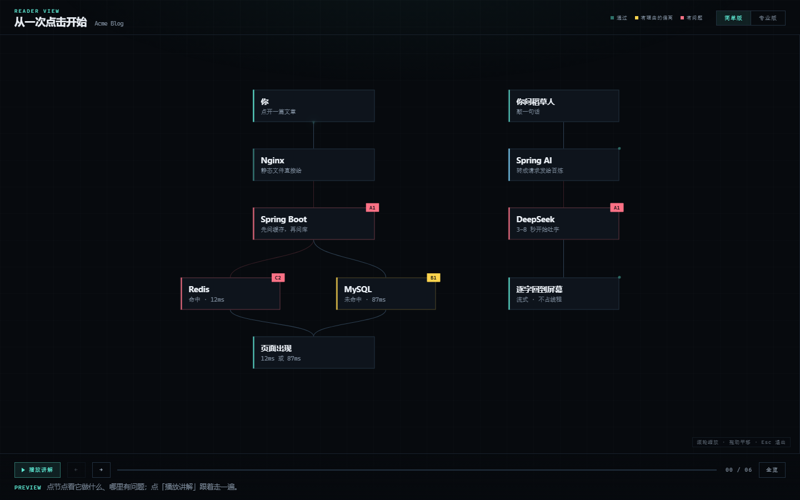

# Java 后端架构检查表

> 给 Spring Boot 项目做架构体检：20 项判据逐条过，输出一份会动的 HTML 报告。

不是规范，是核对。它不告诉你"应该怎么设计"，只回答一件事：**你现在这套，哪儿撑不住。**



## 它解决什么

接手一个跑了一阵的 Java 项目，最难的往往不是读懂代码，是回答这些问题：

- 200 并发下，最先崩的是哪儿？
- 这个缓存策略，发完文章读者多久能看到？
- 这段多表写入，中途失败会留下半条数据吗？
- Agent 接上写工具之后，提示注入能造成什么后果？

这些问题都有确切答案、都能被验证，但很少有人把它们整理成一份**可以照着勾**的清单。这 20 项就是那份清单。

## 长什么样

报告不是一张静态图，是三样东西：

| 交互 | 给人什么 |
|---|---|
| **点节点** | 右侧滑出面板：它在这一步干什么、这处有什么问题、证据在哪、怎么改、改完怎么验 |
| **播放讲解** | 一步一步走，当前步高亮、其余压暗，底部一句旁白 |
| **光点** | 速度 = 该段的**真实延迟**。2ms 一闪而过，3.2s 龟速爬——哪里慢不用看数字 |

另外支持滚轮缩放（以指针为锚点）、拖动平移、面板拉宽（拉宽即放大内文）。

**报告是单文件、零依赖、双击即开**——发给别人不用配环境，离线也能看。

## 20 项覆盖什么

| 域 | 项数 | 关心什么 |
|---|---|---|
| **A 线程与异步** | 4 | 慢调用占不占请求线程、SSE、`synchronized` 里的 IO、异步池是否混用 |
| **B 连接池** | 3 | 池大小算没算过、`maxLifetime` 与 `wait_timeout` 的关系、报错语义 |
| **C 缓存** | 3 | 写后可见性、击穿、清缓存的时机 |
| **D 事务与分层** | 3 | 多表写入的原子性、`@Transactional` 自调用、事务内做外部调用 |
| **E 接口契约** | 3 | 错误结构是否统一、分页有没有上限、列表接口打几次库 |
| **F 边界与安全** | 3 | 用户自定义样式存什么、Agent 写操作的边界、健康检查的语义 |

每项的判据都写成**可执行的动作**——能 grep、能算、能看配置键，不是"建议启用"。

## 怎么用

```bash
git clone https://github.com/alphaaaaa001/Java-arch-check.git ~/.workbuddy/skills/java-arch-check
```

然后把项目路径丢给它，说一句「帮我看看这个后端架构行不行」。

它会先问你一句：要**简单版**（从一次请求走起，讲给不熟这套栈的人）还是**专业版**（五层运行时，带池大小和线程模型）——两个都做也行。

## 设计原则

- **全部要报**：20 项一项不落，通过项也标出来。不做"只报问题"的过滤。
- **不说空话**：每条结论要么能指到 `文件:行`、配置键或命令输出，要么标「未验证」。不拿配置默认值当运行事实。
- **不列建议**：不写"你还可以加 X"。要加中间件，先过三问——解决什么瓶颈 / 运维债多少 / 不加它怎么降级。
- **检查表不是重构方案**：发现 10 个问题，不代表要改 10 个。

⚠️ 也不等于 ✅。「知道自己在偏离」本身就是信息，报告里要写清理由；写不出理由，就等于 ❌。

## 文件结构

```
.
├── SKILL.md              怎么问、怎么查、怎么用（93 行）
├── SPEC.md               产物规范 + 交付前验收清单（54 行）
├── CHECKLIST.md          20 项判据，每项三列（73 行）
├── templates/
│   └── arch-map.html     数据驱动的单文件报告模板（837 行）
└── assets/
    └── screenshot.png
```

`templates/arch-map.html` 里有一段 `const DATA = {...}`，是整份报告的唯一数据源。换项目时整段替换它即可，布局与连线自动重算。

**这份数据同时给人和 AI 读**：问题 id（`A1` / `C2` / `D0`）是共同索引，看完报告想追问，直接说"讲讲 A1"就行。

## 适用范围

**适合**：已有的 Java / Spring Boot 项目，想在上线前、接手后、压测前做一次系统自查。

**不适合**：非 Java 栈（判据全不对口）；纯代码风格 review（那是 lint 的事）；从零做架构选型（这张表是核对现状，不是设计新系统）。

## 参考与致谢

- **视觉规范**：来自 [Refactoring UI](https://www.refactoringui.com)（Adam Wathan & Steve Schoger）的层级、间距、字号、色彩原则；`SPEC.md` 里的验收清单据此整理。
- **访谈式提问**：一次问一个、每题给推荐答案、能查代码就别问——这个工作方式来自 Matt Pocock 的 skills。
- **20 项判据**：来自真实项目的排查实践，**不是权威标准**。不同技术栈、不同规模下结论会变，欢迎按自己的场景改。

## License

[MIT](LICENSE)
